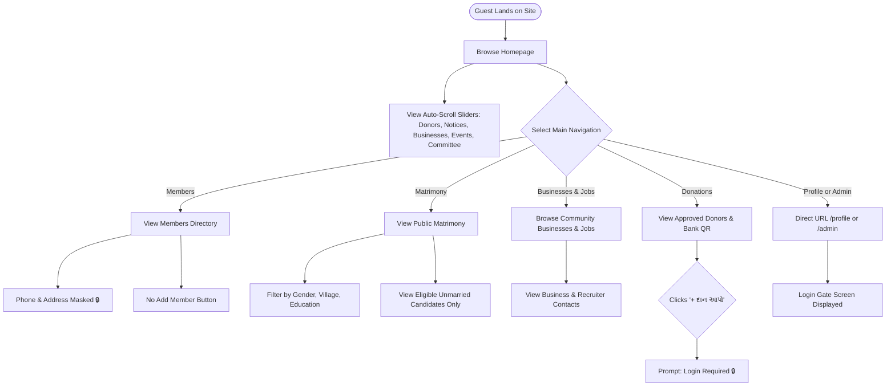
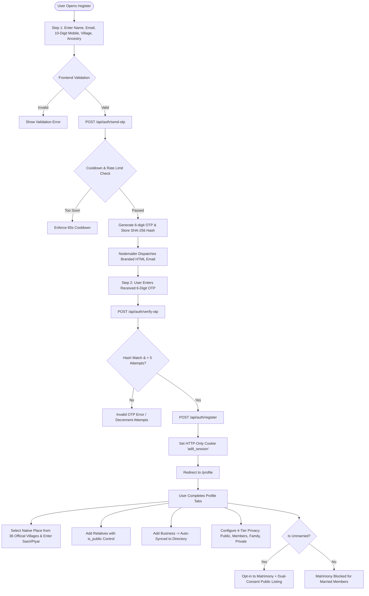
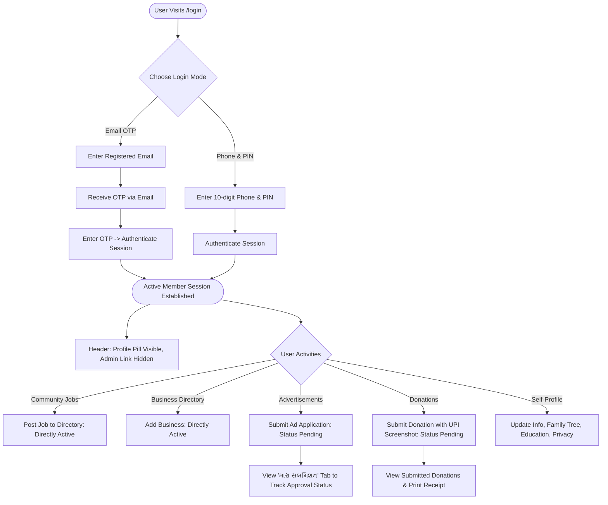
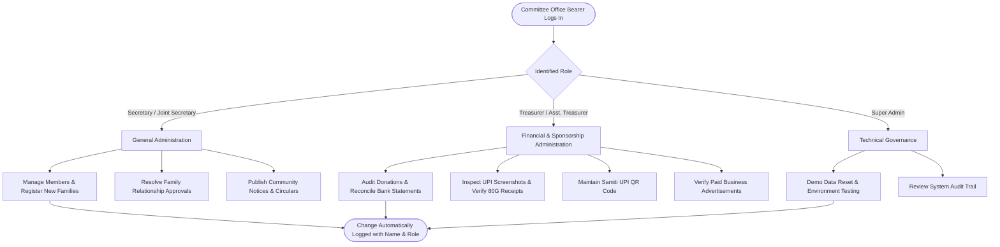
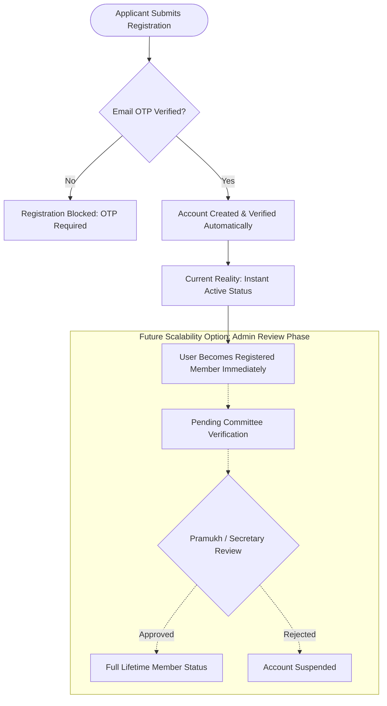
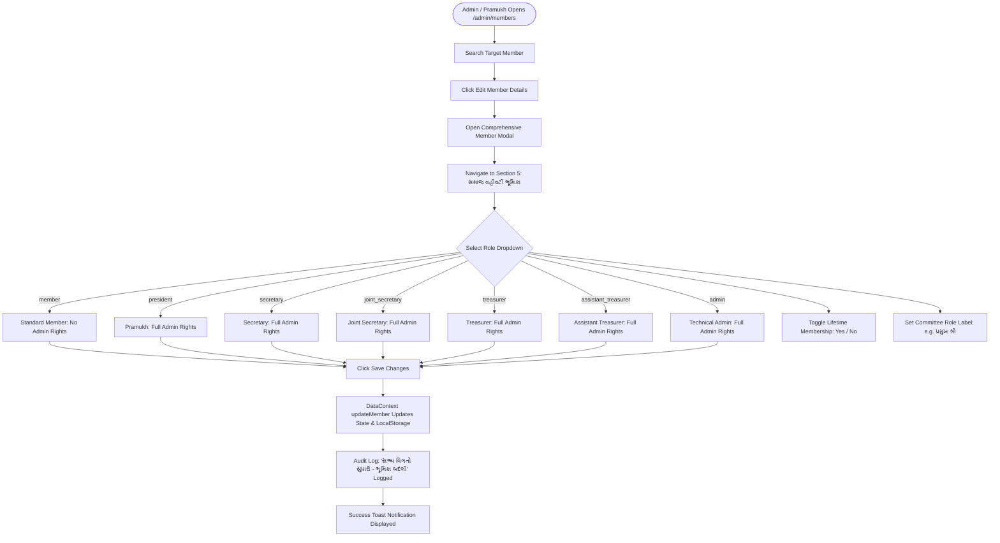

# Adaatham Darji Seva Samiti: Complete User Roles, Permissions & Flow Audit

**Document Version:** 1.0.0  
**Audit Date:** November 7, 2026  
**Project:** Adaatham Darji Seva Samiti, Modasa (`d:\AdaadthamSamaj`)  
**Target File:** `USER_ROLES_AND_FLOWS_AUDIT.md`  
**Classification:** Codebase Architecture, Security & User Journey Audit  

---

## 1. Executive Summary & Audit Scope

This document provides a comprehensive, ground-truth audit of all user roles, access control boundaries, data visibility rules, and workflow journeys currently implemented in the **Adaatham Darji Seva Samiti** digital portal.

### Audit Methodology
This audit was performed strictly against the actual codebase as it exists today on disk:
- **Client Application & Routing:** Next.js 16 (App Router), React 19, Tailwind CSS.
- **State Management & Authorization:** React Contexts ([`AuthContext.tsx`](file:///d:/AdaadthamSamaj/src/context/AuthContext.tsx) and [`DataContext.tsx`](file:///d:/AdaadthamSamaj/src/context/DataContext.tsx)), client-side storage synchronization (`localStorage`), and in-memory mock datasets ([`mockData.ts`](file:///d:/AdaadthamSamaj/src/lib/mockData.ts)).
- **Server API & Verification Backend:** Next.js Route Handlers (`/api/auth/*`), Nodemailer SMTP transport ([`email.ts`](file:///d:/AdaadthamSamaj/src/lib/email.ts)), cryptographically secure in-memory OTP engine ([`otpStore.ts`](file:///d:/AdaadthamSamaj/src/lib/otpStore.ts)), and HTTP-only session cookie issuance.
- **Target Relational Schema & Security Model:** Supabase PostgreSQL Schema ([`database.sql`](file:///d:/AdaadthamSamaj/src/lib/database.sql)) including PostgreSQL Row Level Security (RLS) policies, custom enumeration types, and storage bucket access rules.

Every assertion, permission mapping, and journey step documented herein is cross-referenced with exact source file paths and line ranges.

---

## 2. Application Architecture Relevant to User Flows

The Adaatham Darji Seva Samiti platform operates on a **dual-layer architecture**:

```
┌─────────────────────────────────────────────────────────────────────────────┐
│                       1. CLIENT RUNTIME LAYER (Next.js)                     │
│                                                                             │
│   ┌────────────────────┐   ┌────────────────────┐   ┌───────────────────┐   │
│   │    AuthContext     │   │    DataContext     │   │  Header & Routes  │   │
│   │ - currentUser      │   │ - members, ads     │   │ - Role Switcher   │   │
│   │ - isAdmin (all 5)  │   │ - donations, logs  │   │ - Dynamic CTAs    │   │
│   │ - localStorage sync│   │ - in-memory CRUD   │   │ - Guest locks     │   │
│   └─────────┬──────────┘   └─────────┬──────────┘   └─────────┬─────────┘   │
└─────────────┼────────────────────────┼────────────────────────┼─────────────┘
              │                        │                        │              
┌─────────────▼────────────────────────▼────────────────────────▼─────────────┐
│                  2. SERVER VERIFICATION & API LAYER (Next.js)               │
│                                                                             │
│   ┌────────────────────┐   ┌────────────────────┐   ┌───────────────────┐   │
│   │ /api/auth/send-otp │   │/api/auth/verify-otp│   │/api/auth/register │   │
│   │ - 6-digit random   │   │ - SHA-256 compare  │   │ - Validate Mobile │   │
│   │ - Nodemailer SMTP  │   │ - 5-min TTL expiry │   │ - Set HTTP Cookie │   │
│   │ - 60s cooldown     │   │ - Issue ad8_session│   │ - Verify required │   │
│   └────────────────────┘   └────────────────────┘   └───────────────────┘   │
└──────────────────────────────────────┬──────────────────────────────────────┘
                                       │ (Target Schema Blueprint)             
┌──────────────────────────────────────▼──────────────────────────────────────┐
│                  3. SUPABASE POSTGRESQL SCHEMA (database.sql)               │
│                                                                             │
│   ┌────────────────────┐   ┌────────────────────┐   ┌───────────────────┐   │
│   │ 12 Relational Tbls │   │  6 Storage Buckets │   │    Postgres RLS   │   │
│   │ - members, otp_codes│  │ - member-photos    │   │ - Public SELECT   │   │
│   │ - donations, events│   │ - payment-proofs   │   │ - User UPDATE self│   │
│   │ - matrimony, ads   │   │   (Strict Private) │   │ - Admin overrides │   │
│   └────────────────────┘   └────────────────────┘   └───────────────────┘   │
└─────────────────────────────────────────────────────────────────────────────┘
```

### Architectural Key Characteristics
1. **Client-First Runtime State:**
   - Active user authentication is governed by [`AuthContext.tsx`](file:///d:/AdaadthamSamaj/src/context/AuthContext.tsx#L42-L85). User switching, credential testing, and instant session changes use `currentUser` state synchronized to `localStorage.getItem("ad8_auth_user_id")`.
   - All community data (members, donations, advertisements, events, family relationships, activity logs) is maintained in [`DataContext.tsx`](file:///d:/AdaadthamSamaj/src/context/DataContext.tsx#L140-L195) and synchronized to browser local storage via structured storage keys (`ad8_data_members`, `ad8_data_donations`, etc.).
2. **Server-Side OTP & Cookie Layer:**
   - Real email dispatching is implemented via Nodemailer in [`src/lib/email.ts`](file:///d:/AdaadthamSamaj/src/lib/email.ts#L15-L30) connecting to configured SMTP host/credentials.
   - OTP generation and SHA-256 hash validation are handled by [`src/lib/otpStore.ts`](file:///d:/AdaadthamSamaj/src/lib/otpStore.ts#L24-L80) with a 5-minute time-to-live (TTL) and 60-second resend cooldown.
   - Upon successful verification, `/api/auth/verify-otp` and `/api/auth/register` set an HTTP-only session cookie named `ad8_session` with `maxAge = 7 days` ([`verify-otp/route.ts#L62-L68`](file:///d:/AdaadthamSamaj/src/app/api/auth/verify-otp/route.ts#L62-L68)).
3. **Database Blueprint:**
   - [`src/lib/database.sql`](file:///d:/AdaadthamSamaj/src/lib/database.sql) defines the complete production database schema, custom enum types (`admin_role`, `privacy_visibility`), 12 relational tables, Row Level Security (RLS) policies, and Supabase Storage bucket security policies.

---

## 3. Role Inventory & Authorization Taxonomy

The application defines roles across three layers: TypeScript types, runtime credentials, and database enum definitions.

### Complete Role Inventory

| # | Code Role Identifier | Gujarati Title | English Title | Context Level | Administrative Privileges |
|---|----------------------|----------------|---------------|---------------|---------------------------|
| 1 | `guest` | અતિથિ / મુલાકાતી | Unauthenticated Guest | Logged out (`currentUser === null`) | **None** (Read-only views, all mutations locked) |
| 2 | `member` | સામાન્ય સભ્ય | Registered Member | Authenticated Member (`role: "member"`) | **Self-Management Only** (Profile, Own Family, Own Business, Submit Ad, Donate) |
| 3 | `president` | પ્રમુખ શ્રી | President | Committee Bearer (`role: "president"`) | **Full Administrator** (All modules, members, finances, approvals) |
| 4 | `secretary` | મંત્રી શ્રી | General Secretary | Committee Bearer (`role: "secretary"`) | **Full Administrator** (Equal access with President) |
| 5 | `joint_secretary` | સહમંત્રી શ્રી | Joint Secretary | Committee Bearer (`role: "joint_secretary"`) | **Full Administrator** (Equal access with President) |
| 6 | `treasurer` | ખજાનચી શ્રી | Treasurer | Committee Bearer (`role: "treasurer"`) | **Full Administrator** (Equal access with President) |
| 7 | `assistant_treasurer`| સહ ખજાનચી શ્રી | Assistant Treasurer | Committee Bearer (`role: "assistant_treasurer"`) | **Full Administrator** (Equal access with President) |
| 8 | `admin` | એડમિન | Super Admin | Technical Admin (`role: "admin"`) | **Full Administrator** (Fallback system admin) |

### Equalized Committee Bearer Model
Under current implementation ([`AuthContext.tsx#L266-L273`](file:///d:/AdaadthamSamaj/src/context/AuthContext.tsx#L266-L273)), all five executive committee roles plus `admin` share identical administrative rights:

```typescript
// src/context/AuthContext.tsx lines 266-273
const role = currentUser?.role;
const isCommitteeAdmin = [
  "president",
  "secretary",
  "joint_secretary",
  "treasurer",
  "assistant_treasurer",
  "admin",
].includes(role || "");
const isAdmin = isCommitteeAdmin;
const canManageMembers = isCommitteeAdmin;
const canManageFamilies = isCommitteeAdmin;
const canManageFinances = isCommitteeAdmin;
const canManageEvents = isCommitteeAdmin;
```

Every committee bearer has full authority to:
- Access the Admin Portal (`/admin/*`).
- View and edit **any** member's profile ([`ProfilePage#L137-L142`](file:///d:/AdaadthamSamaj/src/app/profile/page.tsx#L137-L142)).
- Approve or reject family relationships ([`AdminFamiliesPage`](file:///d:/AdaadthamSamaj/src/app/admin/families/page.tsx)).
- Verify bank payments and approve donations ([`AdminDonationsPage`](file:///d:/AdaadthamSamaj/src/app/admin/donations/page.tsx)).
- Approve or reject business advertisements ([`AdminAdvertisementsPage`](file:///d:/AdaadthamSamaj/src/app/admin/advertisements/page.tsx)).
- Manage public matrimony listings and toggle privacy overrides ([`AdminMatrimonyPage`](file:///d:/AdaadthamSamaj/src/app/admin/matrimony/page.tsx)).
- Promote or demote user roles ([`AdminMembersPage#L543-L558`](file:///d:/AdaadthamSamaj/src/app/admin/members/page.tsx#L543-L558)).

---

## 4. Guest / Unauthenticated Visitor Flow

A guest is any visitor accessing the site where `currentUser === null`.

### What Guests Can See
1. **Public Homepage (`/`):**
   - Hero banner with Chamunda Mataji Temple darshan and prayer.
   - Single-line continuous horizontal auto-scrolling sliders:
     - Verified Donors ticker.
     - Important Announcements and Circulars.
     - Registered Community Businesses and Industries.
     - Upcoming Community Events.
     - Executive Committee Office Bearers slider ([`page.tsx`](file:///d:/AdaadthamSamaj/src/app/page.tsx)).
   - Public statistics counters (Members, Families, Businesses, Events).
2. **Members Directory (`/members`):**
   - Public listing of community members.
   - Member search by name, city, native place, occupation, or business.
   - Filter dropdowns for City and Native Place.
   - Detail modal for each member:
     - Name, Photo (if `privacy.photo === "public"`).
     - Native place, city, education category, and business.
3. **Public Matrimony Directory (`/matrimony`):**
   - Candidate cards for members who meet all four eligibility criteria:
     1. `marital_status === "Unmarried"`.
     2. `is_available === true`.
     3. `is_public_listing === true`.
     4. `is_saved === true`.
   - Filter by Gender, Native Place (36 mandal villages), and Education.
   - View Candidate Details modal (Height, Complexion, Bio, Partner Expectations).
4. **Community Businesses (`/businesses` & `/businesses/[id]`):**
   - Active, approved business profiles.
   - Search by keyword and category filters.
5. **Community Jobs (`/jobs`):**
   - Active job postings, job requirements, salary ranges, and recruiter contact numbers.
6. **Advertisements Showcase (`/advertisements`):**
   - Approved business advertisement banners and promo cards.
7. **Events & Gallery (`/events` & `/events/[id]`):**
   - Upcoming and past events, dates, times, locations, and photo galleries.
8. **Donations & Donors (`/donations` & `/donors`):**
   - Verified donations list (filtered to exclude rejected or pending donations).
   - Samiti official bank account details, IFSC, Branch, and UPI QR Code.
   - Search donors by name, year, and purpose.
9. **Executive Committee (`/committee`):**
   - Official list of executive bearers, trustees, and advisory board.

### What Guests Cannot See or Do (Hard Restrictions & Removed Action Buttons)
1. **No Action Buttons Rendered:**
   - On `/members`: "+ નવા સભ્ય ઉમેરો" button is completely hidden (`{currentUser && ...}`) ([`src/app/members/page.tsx#L94-L100`](file:///d:/AdaadthamSamaj/src/app/members/page.tsx#L94-L100)).
   - On `/jobs`: "+ નોકરીની જાહેરાત મૂકો" button is hidden ([`src/app/jobs/page.tsx#L127-L135`](file:///d:/AdaadthamSamaj/src/app/jobs/page.tsx#L127-L135)).
   - On `/advertisements`: Submitting an ad requires authentication; unauthenticated clicks trigger a modal login prompt ([`src/app/advertisements/page.tsx#L100-L104`](file:///d:/AdaadthamSamaj/src/app/advertisements/page.tsx#L100-L104)).
   - On `/donations`: Clicking "+ દાન આપો" prompts login requirement ([`src/app/donations/page.tsx#L141-L145`](file:///d:/AdaadthamSamaj/src/app/donations/page.tsx#L141-L145)).
2. **Private Member Information Masked:**
   - Phone numbers and home addresses of members are masked with `🔒` unless explicitly configured as `public` ([`src/app/members/page.tsx#L61-L74`](file:///d:/AdaadthamSamaj/src/app/members/page.tsx#L61-L74)).
   - In `/matrimony`, phone contact is masked unless `privacy.show_contact === true` ([`src/app/matrimony/page.tsx#L499-L513`](file:///d:/AdaadthamSamaj/src/app/matrimony/page.tsx#L499-L513)).
3. **Protected Routes Blocked:**
   - Accessing `/profile` displays the **Member Security Zone Login Gate** with quick login CTAs ([`src/app/profile/page.tsx#L950-L1040`](file:///d:/AdaadthamSamaj/src/app/profile/page.tsx#L950-L1040)).
   - Accessing `/admin` or any `/admin/*` route displays the **Secure Admin Portal Gate** ("કારોબારી એડમિન લૉગિન જરૂરી છે") ([`src/app/admin/layout.tsx#L40-L98`](file:///d:/AdaadthamSamaj/src/app/admin/layout.tsx#L40-L98)).

---

## 5. Normal Registered Member Flow

A normal registered user has `currentUser !== null` and `currentUser.role === "member"`.

### Navigation & Header Changes
- Header displays user thumbnail photo, first name, and "પ્રોફાઇલ" pill link leading to `/profile` ([`Header.tsx#L243-L262`](file:///d:/AdaadthamSamaj/src/components/Header.tsx#L243-L262)).
- Logout icon button is visible.
- The Admin Panel link (`/admin`) is **not** displayed in the navbar.

### Available Member Capabilities
1. **Interactive Directory Actions:**
   - On `/members`: Can view phone numbers and addresses marked with `privacy: "members"` or `"public"`.
   - On `/members`: Can click "+ નવા સભ્ય ઉમેરો" to launch registration.
   - On `/businesses`: Can submit a new business profile; automatically assigned `owner_id: currentUser.id`.
   - On `/jobs`: Can post new job openings (`posted_by: currentUser.id`).
   - On `/advertisements`:
     - Can submit a business advertisement application (status starts as `pending`).
     - Accesses "મારા સબમિશન (My Submissions)" tab to monitor approval status, view approval timestamps, or read rejection remarks.
   - On `/donations`:
     - Can submit a donation submission form with donor name, multi-entry "હસ્તે" list, amount, purpose, donor photo, and payment proof screenshot.
     - View receipt numbers (`ADS-YYYY-XXX`).
2. **Full Self-Profile Management (`/profile`):**
   - **General Information:** Update name, email, phone, native place (from 36 official mandal villages), sasri name, piyar name, marital status, blood group, profile photo.
   - **Family Tree & Vanshvali:**
     - Add relatives (Father, Mother, Husband, Wife, Son, Daughter, Brother, Sister, In-laws, Uncle, Aunt).
     - Add non-registered family members or link existing members.
     - Toggle `is_public` (whether family member's details can be shown to other members).
   - **Business & Employment:**
     - Manage business details (Owner name, firm name, category, role, city, address, banner photo).
     - Auto-syncs to the community business directory upon saving ([`ProfilePage#L845-L875`](file:///d:/AdaadthamSamaj/src/app/profile/page.tsx#L845-L875)).
     - Manage job/employment details (Sector: Government vs Private, Company, Job title, Experience).
   - **Education:**
     - Select from 9 standardized education categories (`SAMITI_EDUCATION_CATEGORIES`).
     - Enter specific degree or qualifications (`highest_degree` / `education_details`).
     - Add child/dependent education records with public toggle.
   - **Matrimony Profile:**
     - Only accessible if `marital_status === "Unmarried"`.
     - Toggle "Available for Matrimony" checkbox.
     - Toggle "Consent for Public Listing" (dual-consent model).
     - Enter physical attributes (Height, Complexion), personal bio, partner expectations.
     - Configure granular matrimony privacy settings (show name, photo, age, native place, education, occupation, phone contact).
   - **Privacy Settings (4-Tier Access Control):**
     - Phone: `public` | `members` | `family` | `private`.
     - Address: `public` | `members` | `family` | `private`.
     - Photo: `public` | `members` | `family` | `private`.
     - Family: `public` | `members` | `family` | `private`.
     - Business: `public` | `members` | `family` | `private`.
     - Employment: `public` | `members` | `family` | `private`.
     - Education: `public` | `members` | `family` | `private`.
   - **My Donations History:**
     - View all donations made by the user, payment status, approval status, and print/download receipts.

### Normal Member Restrictions
- If a normal member attempts to navigate directly to `/admin` or any `/admin/*` subpage:
  - [`AdminLayout.tsx#L101-L135`](file:///d:/AdaadthamSamaj/src/app/admin/layout.tsx#L101-L135) catches the session where `!isAdmin`.
  - The UI renders an **Access Denied (ઍક્સેસ પ્રતિબંધિત)** screen informing the user that the admin panel is reserved for committee office bearers.
  - No admin APIs or mutating administrative functions can be triggered.
- A normal member cannot view or edit another member's profile on `/profile`. The query parameter `?memberId=XYZ` is strictly ignored unless `isAdmin === true` ([`src/app/profile/page.tsx#L137-L142`](file:///d:/AdaadthamSamaj/src/app/profile/page.tsx#L137-L142)).

---

## 6. Pramukh (President) Administrator Flow

The Pramukh user (`role: "president"`, default credential Dineshbaahi Babubhai Darji, `mem-1`) holds executive leadership authority.

### Entry Points & Header
- Header displays the prominent **"એડમિન પેનલ"** badge link in the navigation row ([`Header.tsx#L223-L238`](file:///d:/AdaadthamSamaj/src/components/Header.tsx#L223-L238)).
- Profile pill indicates presidential committee role.

### Admin Dashboard Overview (`/admin`)
- Displays live statistics counters:
  - Total Members, Families, Businesses, Events, Donations.
  - Pending Approvals Counters (Pending Relationships, Pending Ads, Pending Donations).
  - Verified Total Funds collected.
  - Active Public Matrimony candidates count.
- Charts and Visualizations:
  - Donations by Purpose (Bar Chart).
  - Geographic distribution of members by city (Pie Chart).
- **Admin Activity Log (Audit Trail):**
  - Live timeline showing every administrative action, actor name, role, timestamp, target, and change details ([`page.tsx#L406-L450`](file:///d:/AdaadthamSamaj/src/app/admin/page.tsx#L406-L450)).

### Seven Administrative Sub-Modules Available to Pramukh
1. **Member Master Management (`/admin/members`):**
   - Search across all members by name, city, native place, or phone.
   - Filter by role and lifetime membership.
   - **Full Profile Editing of Any Member:** Edit all 5 sections (Personal info, Native place dropdown, Sasri/Piyar names, Education, Business, Role elevation, Matrimony toggle).
   - **Role Elevation / Assignment:** Change any member's role to `president`, `secretary`, `joint_secretary`, `treasurer`, `assistant_treasurer`, `admin`, or `member`.
   - Toggle Lifetime Membership (`is_lifetime_member`).
   - Delete member from system.
2. **Family Relationship Approvals (`/admin/families`):**
   - Review pending family tree relationship requests submitted by members.
   - Approve relationship (updates status to `approved`, stamps `approved_by: "દિનેશભાઈ બાબુલાલ દરજી"`, and integrates into digital vanshvali).
   - Reject relationship (updates status to `rejected`).
   - Delete obsolete relationship links.
3. **Business Advertisements Approval (`/admin/advertisements`):**
   - Filter ads by `pending`, `approved`, `rejected`, or `all`.
   - Preview full banner graphic, business description, owner, and contact.
   - Approve advertisement: activates ad on the public portal and homepage auto-scroll carousel.
   - Reject advertisement: prompts mandatory rejection remarks modal explaining reason to applicant.
   - Delete advertisements.
4. **Donation Verification & Accounts (`/admin/donations`):**
   - Filter donations by `pending`, `approved`, `rejected`.
   - View donor photo, "હસ્તે" names, purpose, amount, and payment date.
   - **Inspect Payment Proof Screenshot:** View uploaded UPI / NEFT bank transfer proof in preview modal.
   - **Verify & Approve:** Marks `payment_status: "verified"` and `status: "approved"`, stamps receipt number.
   - **Reject Donation:** Requires rejection remarks.
   - **Configure Samiti Bank Details:** Modal to update Account Holder Name, Bank Name, Account Number, IFSC Code, Branch, UPI ID, and official UPI QR Code image URL.
5. **Community Events Management (`/admin/events`):**
   - Create new community event (Title, Date, Time, Location, Description, Cover image).
   - Edit upcoming/past events.
   - Delete events.
6. **Executive Committee Management (`/admin/committee`):**
   - View and manage executive committee list, order of precedence, and trustee designations.
7. **Matrimony Administration (`/admin/matrimony`):**
   - Inspect all matrimony applicants (Unmarried, Engaged, Married).
   - View full candidate dossier: age, height, complexion, native place, education, occupation, guardian details, bio, partner expectations.
   - **Public Listing Toggle:** Approve or suspend public visibility on `/matrimony`.
   - **Eligibility Enforcement:** Prevents non-unmarried members from being set to public listing.
   - Update contact privacy overrides.

### Cross-Profile Admin Override on `/profile`
- When the Pramukh opens `/profile?memberId=XYZ`:
  - [`ProfilePage#L137-L142`](file:///d:/AdaadthamSamaj/src/app/profile/page.tsx#L137-L142) activates the admin override hook.
  - The profile page loads the target member's details instead of the Pramukh's own profile.
  - Saves made update the target member and record an entry in the Audit Log with `currentUser.name`.

---

## 7. Other Committee Role Flows (`secretary`, `joint_secretary`, `treasurer`, `assistant_treasurer`, `admin`)

### Current Code Reality: Identical Permissions
In the current application code, **all committee roles have equal permissions** to the Pramukh.

| Role | Default Test Identity | Assigned Credentials | Functional Focus in UI Summary | Implemented Code Permissions |
|------|----------------------|----------------------|--------------------------------|------------------------------|
| `secretary` (મંત્રી) | Mahendrabhai Kanjibhai Darji (`mem-4`) | Phone: `9825000002`<br>PIN: `123456` | General management, circulars, notifications, member records | **Full Administrator** (`isAdmin: true`, all 7 admin modules accessible) |
| `joint_secretary` (સહમંત્રી) | Hasmukhbhai Ranchhodbhai Darji (`mem-5`) | Phone: `9825000003`<br>PIN: `123456` | Member communications, directory updates, business directory | **Full Administrator** (`isAdmin: true`, all 7 admin modules accessible) |
| `treasurer` (ખજાનચી) | Rameshbhai Maganlal Darji (`mem-6`) | Phone: `9825000004`<br>PIN: `123456` | Accounts, bank verification, donation receipts, 80G tracking | **Full Administrator** (`isAdmin: true`, all 7 admin modules accessible) |
| `assistant_treasurer` (સહ ખજાનચી) | Nareshbhai Kantilal Darji (`mem-7`) | Phone: `9825000007`<br>PIN: `123456` | Sponsorships, advertisement billing, donor ledger assistance | **Full Administrator** (`isAdmin: true`, all 7 admin modules accessible) |
| `admin` (એડમિન) | System Administrator | System level | IT & technical system governance | **Full Administrator** (`isAdmin: true`, all 7 admin modules accessible) |

### Functional Workflows by Focus Area
While all committee bearers can perform all actions in code, their user journeys align around specific samiti responsibilities:
- **Secretary & Joint Secretary Workflow:** Focus primarily on `/admin/members` (editing profiles, issuing membership), `/admin/families` (resolving relationship disputes), and `/admin/events` (creating meeting notices and circulars).
- **Treasurer & Assistant Treasurer Workflow:** Focus primarily on `/admin/donations` (cross-referencing bank statements against uploaded UPI screenshots, approving receipts, updating Samiti QR codes) and `/admin/advertisements` (checking paid sponsorship banners).
- **Technical Admin Workflow:** Manages demo data resets (`resetDemoData()`), tests roles via the Quick Switcher, and reviews security audit logs.

---

## 8. Registration & Verification Flow

The registration and authentication architecture implements a **two-step email OTP verification flow** paired with phone number validation.

### Registration Journey (Step-by-Step)

```
[ Step 1: Member Data Entry ]
User fills: Full Name, Email, Mobile Number, Native Place (dropdown),
City, Father Name, Grandfather Name, Marital Status, Gender, Address, Profession
                         │
                         ▼
[ Client-Side Validation ]
- Name >= 2 characters
- Email contains '@' and valid syntax
- Mobile number cleaned of non-digits
- 10-digit Indian pattern validated (/^[6-9]\d{9}$/)
- Terms & conditions checkbox verified
                         │
                         ▼
[ POST /api/auth/send-otp ]
- Rate Limit Check: 60-second cooldown per email
- Cryptographic 6-digit numeric OTP generated (crypto.randomInt)
- SHA-256 hash stored in otpStore with 5-minute TTL
- Nodemailer SMTP sends branded Gujarati/English HTML email
                         │
                         ▼
[ Step 2: OTP Verification Screen ]
User receives 6-digit OTP in inbox (and preview in dev mode)
Timer displays 60s countdown; Resend OTP enabled once expired
User enters 6 digits
                         │
                         ▼
[ POST /api/auth/verify-otp ]
- Code normalized, trimmed, and regex verified (/^\d{6}$/)
- SHA-256 compared against stored hash
- Checks attempts count (< 5 attempts allowed)
- Returns verification token: { success: true, isVerified: true }
                         │
                         ▼
[ POST /api/auth/register ]
- Checks isEmailVerified === true
- Creates verified Member object with completeness = 75%
- Appends to INITIAL_MEMBERS and DataContext members list
- Sets HTTP-Only Cookie 'ad8_session' (maxAge = 7 days)
- Automatically establishes active session in AuthContext
                         │
                         ▼
[ Automatic Redirection ]
User redirected to /profile to complete family tree & preferences
```

### Verification Security Parameters in Code
- **OTP Generation:** `crypto.randomInt(100000, 999999)` ([`otpStore.ts#L31-L35`](file:///d:/AdaadthamSamaj/src/lib/otpStore.ts#L31-L35)).
- **OTP Hashing:** SHA-256 cryptographic digest ([`otpStore.ts#L24-L26`](file:///d:/AdaadthamSamaj/src/lib/otpStore.ts#L24-L26)). Raw OTP is never retained in memory after creation.
- **Expiry:** Strict 5-minute timeout (`OTP_TTL_MS = 5 * 60 * 1000`) ([`otpStore.ts#L17`](file:///d:/AdaadthamSamaj/src/lib/otpStore.ts#L17)).
- **Resend Cooldown:** 60-second cooldown (`RESEND_COOLDOWN_MS = 60 * 1000`) ([`otpStore.ts#L18`](file:///d:/AdaadthamSamaj/src/lib/otpStore.ts#L18)).
- **Max Incorrect Attempts:** 5 attempts limit before lockout (`MAX_ATTEMPTS = 5`) ([`otpStore.ts#L19`](file:///d:/AdaadthamSamaj/src/lib/otpStore.ts#L19)).
- **Session Cookie:** `ad8_session` with `httpOnly: true`, `sameSite: "lax"`, `path: "/"`, `maxAge: 7 days` ([`verify-otp/route.ts#L62-L68`](file:///d:/AdaadthamSamaj/src/app/api/auth/verify-otp/route.ts#L62-L68)).

---

## 9. Profile & Details Update Flow

The Profile Page ([`src/app/profile/page.tsx`](file:///d:/AdaadthamSamaj/src/app/profile/page.tsx)) contains 6 specialized tabs:

### 1. સામાન્ય માહિતી (General Information)
- **Profile Photo:** Image upload up to 5MB, base64 / URL preview.
- **Basic Info:** Name, Email, Phone, Gender, Blood Group, Marital Status.
- **Native Place (મૂળ વતન):** Dropdown populated exclusively from the 36 official villages of the *Adaatham Darji Pragati Mandal, Mumbai* book ([`src/types/index.ts#L384-L422`](file:///d:/AdaadthamSamaj/src/types/index.ts#L384-L422)):
  *અડાઆઠમ, બાહ્યરોલ, બાબરાબાદ, બેટાળી, બોલુન્દ્રા, બહાદરપુર, દહેગામડા, દાવલી, ગઢડા, ઘાંટી, ઘોરિવાડા, ખારીવાડા, ખુડાલ, કોકાપુર, લાલપુર, લીંભોઈ, મેઘરજ, મોડાસા, મોતીપુરા, નવલપુર, પાલ્સા, પટેલ છાપરા, પુંજારપુર, રાયગઢ, રાજેન્દ્રનગર, રખિયાલ, રમોસ, રેલ્લાવાડા, સરડોઈ, શામળાપુર, શામળાજી, શ્રીકાંતપુર, તરસવાડા, ટીંટોઈ*.
- **Sasri & Piyar Names:** Specific fields for સાસરીનું નામ (Sasri Name) and પિયરનું નામ (Piyar Name).
- **Ancestry Fields:** Father's name, Grandfather's name, Maternal Uncle's name (મામા), Maternal Grandfather's name (નાના).
- **Family Members Sub-List:** Add family members with name, relation, native place, sasri/piyar names, and `is_public` toggle.

### 2. ગોપનીયતા સેટિંગ્સ (Privacy Settings)
Users control 7 individual data fields across 4 privacy visibility levels:
- `public`: Visible to all internet visitors (including guests).
- `members`: Visible only to authenticated logged-in members.
- `family`: Visible only to approved connected family relatives.
- `private`: Strictly hidden; visible only to self and samiti administrators.

Fields covered: **Phone, Home Address, Photo, Family Relations, Business Details, Employment Details, Education**.

### 3. વ્યવસાય & નોકરી (Business & Employment)
Split into two distinct stacked panels:
- **Upper Panel: Business / વ્યવસાય:**
  - Owner Name, Business Name, Business Category, Role (Owner, Partner, Manager), City, Phone, Address, Banner Image.
  - **Auto-Sync:** Saving automatically updates or creates an entry in the community business directory ([`ProfilePage#L845-L875`](file:///d:/AdaadthamSamaj/src/app/profile/page.tsx#L845-L875)).
- **Lower Panel: Employment / નોકરી:**
  - Full Name, Sector (સરકારી ક્ષેત્ર vs ખાનગી ક્ષેત્ર), Company Name, Job Title, City, Phone, Industry, Experience.

### 4. શિક્ષણની વિગતો (Education)
Simplified into high-impact fields:
- **શિક્ષણ વિભાગ (Education Category):** Dropdown of 9 standard levels (*પ્રાથમિક (ધોરણ ૧-૮), માધ્યમિક (ધોરણ ૯-૧૦), ઉચ્ચતર માધ્યમિક (ધોરણ ૧૧-૧૨), સ્નાતક (Graduation), અનુસ્નાતક (Post Graduation), ડિપ્લોમા / ITI, પ્રોફેશનલ ડીગ્રી (CA, CS, ICWA), ડૉક્ટરેટ (Ph.D), અન્ય શિક્ષણ*).
- **શું અભ્યાસ કર્યો છે? (Degree / Details):** Specific qualification (e.g. "B.Com, MBA, ITI").
- **Family Child Education List:** Name, Institution, Standard/Course, Education Level, Public toggle.

### 5. મેટ્રિમોની પ્રોફાઇલ (Matrimony Profile)
- **Eligibility Check:** Must be `marital_status === "Unmarried"`. Married and engaged members see a blocked notice.
- **Dual-Consent Checkboxes:**
  1. "મેટ્રિમોની માટે ઉપલબ્ધ (Available for Matrimony)".
  2. "જાહેર મેટ્રિમોની લિસ્ટિંગમાં દર્શાવવા સંમતિ (Public Listing Consent)".
- **Attributes:** Height (e.g. 5' 8"), Complexion, Bio / About Me, Partner Expectations.
- **Matrimony Privacy Matrix:** Checkboxes for displaying Name, Photo, Age, Native Place, Education, Occupation, Contact Phone.

### 6. દાનનો ઇતિહાસ (My Donations)
- Displays all donations submitted by the logged-in member.
- Shows status: `પેન્ડિંગ (Pending)`, `માન્ય (Approved)`, `નામંજૂર (Rejected)`.
- Displays Receipt Number and gives Print / Download option.

---

## 10. Approval & Status Management Flow

All user-submitted content requiring administrative oversight follows a structured lifecycle.

```
┌──────────────────┐       Submit        ┌──────────────────┐
│   Normal User    │ ──────────────────> │  Pending State   │
│  (Action Trigger)│                     │  (Hidden Public) │
└──────────────────┘                     └────────┬─────────┘
                                                  │
                                                  │ Committee Review
                                                  ▼
                                         ┌──────────────────┐
                                         │  Admin Decision  │
                                         └────────┬─────────┘
                                                  │
                         ┌────────────────────────┴────────────────────────┐
                         │                                                 │
                         ▼ Approved                                        ▼ Rejected
              ┌─────────────────────┐                           ┌─────────────────────┐
              │   Approved State    │                           │   Rejected State    │
              │ - Public visibility │                           │ - Retained in admin │
              │ - Auto-scroll tickers│                          │ - Reason logged     │
              │ - Receipts stamped  │                           │ - User notified     │
              └─────────────────────┘                           └─────────────────────┘
```

### Detailed Approval Workflows

| Entity | Submission Path | Initial Status | Reviewing Admin Page | Approval Actions | Public Impact |
|--------|-----------------|----------------|----------------------|------------------|---------------|
| **Family Relationships** | `/profile` (Family tab) or `/family-tree` | `pending` | `/admin/families` | Approve / Reject / Delete | Approved relationships appear in digital family tree and vanshvali. |
| **Business Advertisements** | `/advertisements` ("જાહેરાત સબમિટ કરો") | `pending` | `/admin/advertisements` | Approve / Reject (with remarks) / Delete | Approved ads appear on `/advertisements` and homepage auto-scroller. |
| **Donations & Payments** | `/donations` ("+ દાન આપો") | `pending` | `/admin/donations` | Verify & Approve / Reject (with remarks) | Approved donations show on public donor wall and generate receipts. Payment proof remains strictly private. |
| **Matrimony Profiles** | `/profile` (Matrimony tab) | `private` or `public` | `/admin/matrimony` | Toggle Public Listing / Edit Profile | Public candidates appear on `/matrimony`. Ineligible (married) profiles are blocked. |
| **Business Directory** | `/businesses` ("+ વ્યવસાય ઉમેરો") | `active` | Direct add (instant) | Edit / Delete in `/admin` | Directly published if submitted by authenticated user. |
| **Job Postings** | `/jobs` ("+ નોકરી ઉમેરો") | `active` | Direct add (instant) | Delete in `/admin` | Directly published if submitted by authenticated user. |

---

## 11. Public Pages & Content Management Flow

The application carefully balances public discovery for community awareness against privacy protection for sensitive personal information.

### Content Visibility Matrix by Page

| Page Route | Guest (Unauthenticated) Visibility | Normal Registered Member Visibility | Committee Admin Visibility |
|------------|-----------------------------------|--------------------------------------|----------------------------|
| `/` (Homepage) | Public sliders (Donors, Notices, Circulars, Businesses, Events, Committee Bearers). | Same as Guest. | Same as Guest + Link to `/admin`. |
| `/members` | Member cards. Phone and address masked (`🔒`). No "+ ઉમેરો" button. | Member cards. Phone/address visible based on privacy settings. "+ નવા સભ્ય ઉમેરો" button visible. | Full visibility of all member data. Direct edit buttons. |
| `/family-tree` | Search bar first (full tree hidden by default). Contact numbers masked. | Full tree search and expansion. Contact visible for members. | Full tree search, contact visible, relationship links traceable. |
| `/matrimony` | Eligible unmarried public profiles. Contact masked unless consented. | Eligible unmarried public profiles. Contact visible if consented. | Full matrimony candidates list + link to `/admin/matrimony`. |
| `/businesses` | Approved active business cards. Search & category filter. Add button prompts login. | Full access. "+ વ્યવસાય ઉમેરો" opens submission modal. | Full access + admin management options. |
| `/jobs` | Active job postings. Contact persons & numbers visible. Add button hidden. | Active job postings. "+ નોકરી મૂકો" button visible. | Full access + delete job postings. |
| `/advertisements` | Approved ads carousel. Submit ad prompts login. | Approved ads + "મારા સબમિશન" tab with real-time status tracking. | Full list of pending, approved, and rejected ads with review tools. |
| `/donations` | Approved donations ledger and total funds counter. Bank UPI QR code. Submit prompts login. | Approved donations + Bank QR. Submit donation modal with photo/proof upload. | Full ledger with pending donations, proof inspection modal, and bank settings editor. |
| `/committee` | Full committee bearers list and photos. | Same as Guest. | Same as Guest + link to `/admin/committee`. |
| `/profile` | **Blocked:** Renders login gate with CTAs. | **Active:** Manages own personal profile across 6 tabs. | **Supercharged:** Can view/edit own profile OR any member via `?memberId=XYZ`. |
| `/admin/*` | **Blocked:** Renders secure admin login gate. | **Blocked:** Renders Access Denied screen. | **Full Access:** All 7 management modules and activity audit trail. |

---

## 12. Role Permission Comparison Matrix

The following matrix provides an exhaustive cross-comparison of every atomic action across all user roles.

| Feature / Atomic Action | Guest | Member | Secretary | Joint Sec. | Treasurer | Asst. Treas. | Pramukh |
|---|:---:|:---:|:---:|:---:|:---:|:---:|:---:|
| **Public Viewing** | | | | | | | |
| View Home, Sliders & Temple Darshan | ✅ | ✅ | ✅ | ✅ | ✅ | ✅ | ✅ |
| View Public Members Directory | ✅ | ✅ | ✅ | ✅ | ✅ | ✅ | ✅ |
| View Public Matrimony Directory | ✅ | ✅ | ✅ | ✅ | ✅ | ✅ | ✅ |
| View Businesses & Jobs | ✅ | ✅ | ✅ | ✅ | ✅ | ✅ | ✅ |
| View Approved Advertisements | ✅ | ✅ | ✅ | ✅ | ✅ | ✅ | ✅ |
| View Approved Donations & Bank QR | ✅ | ✅ | ✅ | ✅ | ✅ | ✅ | ✅ |
| View Committee Bearers List | ✅ | ✅ | ✅ | ✅ | ✅ | ✅ | ✅ |
| **Privacy Access** | | | | | | | |
| View `public` phone / address | ✅ | ✅ | ✅ | ✅ | ✅ | ✅ | ✅ |
| View `members` phone / address | ❌ | ✅ | ✅ | ✅ | ✅ | ✅ | ✅ |
| View `family` phone / address | ❌ | ⚠️ (rel only) | ✅ | ✅ | ✅ | ✅ | ✅ |
| View `private` phone / address | ❌ | ❌ (self only)| ✅ | ✅ | ✅ | ✅ | ✅ |
| View Donor Payment Proof Screenshots | ❌ | ❌ (own only) | ✅ | ✅ | ✅ | ✅ | ✅ |
| **User Submissions & Mutations** | | | | | | | |
| Register / Verify via Email OTP | ✅ | N/A | N/A | N/A | N/A | N/A | N/A |
| Update Own Profile & 4-Tier Privacy | ❌ | ✅ | ✅ | ✅ | ✅ | ✅ | ✅ |
| Add Family Members to Own Tree | ❌ | ✅ | ✅ | ✅ | ✅ | ✅ | ✅ |
| Add Business to Directory | ❌ | ✅ | ✅ | ✅ | ✅ | ✅ | ✅ |
| Post Job to Directory | ❌ | ✅ | ✅ | ✅ | ✅ | ✅ | ✅ |
| Submit Advertisement for Approval | ❌ | ✅ | ✅ | ✅ | ✅ | ✅ | ✅ |
| Submit Donation with Payment Proof | ❌ | ✅ | ✅ | ✅ | ✅ | ✅ | ✅ |
| Opt-in to Matrimony (Unmarried only)| ❌ | ✅ | ✅ | ✅ | ✅ | ✅ | ✅ |
| **Administrative & Approval Actions** | | | | | | | |
| Access Admin Dashboard (`/admin`) | ❌ | ❌ | ✅ | ✅ | ✅ | ✅ | ✅ |
| Approve / Reject Family Links | ❌ | ❌ | ✅ | ✅ | ✅ | ✅ | ✅ |
| Approve / Reject Advertisements | ❌ | ❌ | ✅ | ✅ | ✅ | ✅ | ✅ |
| Verify & Approve Donations | ❌ | ❌ | ✅ | ✅ | ✅ | ✅ | ✅ |
| Edit Samiti Official Bank & QR Code | ❌ | ❌ | ✅ | ✅ | ✅ | ✅ | ✅ |
| Edit Any Member's Profile | ❌ | ❌ | ✅ | ✅ | ✅ | ✅ | ✅ |
| Assign User Roles & Committee Posts | ❌ | ❌ | ✅ | ✅ | ✅ | ✅ | ✅ |
| Manage Public Matrimony Listings | ❌ | ❌ | ✅ | ✅ | ✅ | ✅ | ✅ |
| Publish Community Events | ❌ | ❌ | ✅ | ✅ | ✅ | ✅ | ✅ |
| View Security Audit Trail (`logs`) | ❌ | ❌ | ✅ | ✅ | ✅ | ✅ | ✅ |

---

## 13. Seven Architectural Mermaid Flow Diagrams

### Diagram 1: Guest User Journey


---

### Diagram 2: Normal Registered User Journey: Registration to Profile Completion


---

### Diagram 3: Normal Registered User Journey: Login to Daily Usage & Updates


---

### Diagram 4: Pramukh User Journey: Daily Administration & Approvals
```mermaid
flowchart TD
    PStart([Pramukh Logs in as President]) --> PHeader[Header: 'એડમિન પેનલ' Link Visible]
    PHeader --> PDash[/admin - Executive Dashboard]

    PDash --> PReview[Review Pending Approvals Counter & Funds Total]
    
    PDash --> PModFam[/admin/families]
    PModFam --> PAppFam[Inspect Relationship Request -> Approve / Reject -> Audit Log Recorded]

    PDash --> PModAds[/admin/advertisements]
    PModAds --> PAppAds[Preview Ad Graphic -> Approve to Homepage Carousel OR Reject with Remarks]

    PDash --> PModDon[/admin/donations]
    PModDon --> PAppDon[Inspect Bank Payment Proof Screenshot -> Verify & Approve -> Receipt Issued]
    PModDon --> PBankConf[Update Samiti Bank Details & Upload Official UPI QR Code]

    PDash --> PModMem[/admin/members]
    PModMem --> PEditMem[Search Member -> Open Full Edit Modal -> Update Data / Assign Role]

    PDash --> PModMat[/admin/matrimony]
    PModMat --> PAppMat[Review Candidates -> Toggle Public Listing -> Check Unmarried Eligibility]

    PDash --> PModEvt[/admin/events]
    PModEvt --> PPubEvt[Publish Community Event Notice]

    PDash --> PLogs[Review Security & Access Audit Trail for All Changes]
```

---

### Diagram 5: Other Roles User Journeys: Task-Specific Administration


---

### Diagram 6: Registration Approval Flow (Current Implementation State)


---

### Diagram 7: Role Assignment & Elevation Flow


---

## 14. Security & Permission Findings

### 1. Client-Side Route Guards vs Server Enforcement
- **Client Guards:** Route protection for `/admin/*` is enforced by client-side conditional rendering in [`AdminLayout.tsx`](file:///d:/AdaadthamSamaj/src/app/admin/layout.tsx#L40-L135). If `!currentUser` or `!isAdmin`, an informative block screen is displayed.
- **Absence of Server Middleware:** There is currently no root `middleware.ts` intercepting incoming HTTP requests before rendering Next.js pages. An advanced client could inspect JavaScript bundles or manipulate client state unless the backend API routes enforce their own checks.
- **API Handler Protection:** `/api/auth/register` strictly requires `isEmailVerified === true` before creating an account ([`register/route.ts#L69-L77`](file:///d:/AdaadthamSamaj/src/app/api/auth/register/route.ts#L69-L77)).

### 2. Session Cookie vs Context State
- Successful login or registration via `/api/auth/verify-otp` and `/api/auth/register` issues an HTTP-only cookie named `ad8_session` containing the user's normalized email ([`verify-otp/route.ts#L62-L68`](file:///d:/AdaadthamSamaj/src/app/api/auth/verify-otp/route.ts#L62-L68)).
- However, the client Next.js runtime reads active user authentication from `localStorage` (`ad8_auth_user_id`). This makes client state switching effortless for demonstrations, but requires a unified session synchronization pattern for production backend deployments.

### 3. PostgreSQL Row Level Security (RLS) Alignment
- The production Supabase blueprint ([`database.sql#L275-L353`](file:///d:/AdaadthamSamaj/src/lib/database.sql#L275-L353)) defines sound security rules:
  - `otp_codes`: Strict backend service-role only (`USING (false)`).
  - `members`: Users can only update their own record (`auth.uid() = auth_user_id`).
  - `donations`: Public query allows only approved, consented donations.
  - `payment-proofs`: Storage policy restricts read access exclusively to the proof owner or committee administrators (`president`, `treasurer`, `assistant_treasurer`, `secretary`, `admin`) ([`database.sql#L342-L353`](file:///d:/AdaadthamSamaj/src/lib/database.sql#L342-L353)).

---

## 15. Issues, Gaps, Discrepancies, and Unclear Behaviour

1. **In-Memory Store vs Supabase Persistence:**
   - The application has two layers: a fully functional Next.js client-side application driven by React Contexts synchronized to `localStorage`, and a target Supabase SQL schema. Mutated members, donations, or advertisements persist across browser reloads via `localStorage`, but are not yet synced to a live remote PostgreSQL server.
2. **All Five Committee Bearers Share Full Admin Powers:**
   - Originally, `roleCredentials.ts` documented distinct responsibilities (e.g., Treasurer for finances, Secretary for records). However, per the latest update, all five roles evaluate to `isAdmin === true` in `AuthContext.tsx` with identical capabilities across all modules. If the Samiti desires strict separation of duties (e.g., only Treasurer can approve donations), explicit role gates must be reintroduced in `AuthContext`.
3. **No Direct Registration Approval Queue:**
   - Once a member verifies their email OTP via `/register`, their account is immediately active (`role: "member"`). There is no "pending admin approval" holding phase for new registrations. They appear immediately in the member directory.
4. **Direct Publication of Businesses & Jobs:**
   - Authenticated members who add a business via `/businesses` or `/profile`, or post a job via `/jobs`, have their items published immediately (`status: "active"`). In contrast, business *advertisements* (`/advertisements`) and *donations* (`/donations`) require explicit admin approval (`status: "pending"`).
5. **Dual Authentication Mechanisms:**
   - Both **Email OTP** (production Nodemailer) and **Phone + PIN** (demo shortcut using PIN `123456`) are present in `/login`. This is helpful for demonstrations but should be unified or phone-OTP enabled prior to broad public release.

---

## 16. Code References & Verification Index

| File Path | Lines / Functions | Verified Implementation Fact |
|---|---|---|
| [`src/types/index.ts`](file:///d:/AdaadthamSamaj/src/types/index.ts#L1-L14) | Lines 1–14 | Defines `PrivacyVisibility` and `AdminRole = "president" \| "secretary" \| "joint_secretary" \| "treasurer" \| "assistant_treasurer" \| "admin" \| "member"`. |
| [`src/types/index.ts`](file:///d:/AdaadthamSamaj/src/types/index.ts#L384-L422) | Lines 384–422 | Defines `SAMITI_NATIVE_PLACES` with all 36 official mandal villages. |
| [`src/types/index.ts`](file:///d:/AdaadthamSamaj/src/types/index.ts#L425-L437) | Lines 425–437 | Helper `isMemberEligibleForPublicMatrimony`: enforces unmarried, available, saved, and public consent. |
| [`src/context/AuthContext.tsx`](file:///d:/AdaadthamSamaj/src/context/AuthContext.tsx#L42-L85) | Lines 42–85 | Session initialization, `AUTH_STORAGE_KEY`, `loginAs`, and `currentUser` state. |
| [`src/context/AuthContext.tsx`](file:///d:/AdaadthamSamaj/src/context/AuthContext.tsx#L266-L273) | Lines 266–273 | Confirms all 5 committee roles + admin evaluate to `isAdmin === true` with identical privileges. |
| [`src/context/DataContext.tsx`](file:///d:/AdaadthamSamaj/src/context/DataContext.tsx#L140-L195) | Lines 140–195 | Synchronizes `members`, `relationships`, `businesses`, `advertisements`, `donations`, and `logs` with `localStorage`. |
| [`src/context/DataContext.tsx`](file:///d:/AdaadthamSamaj/src/context/DataContext.tsx#L210-L235) | Lines 210–235 | `approveRelationship` and `rejectRelationship` methods with timestamp and approver tracking. |
| [`src/context/DataContext.tsx`](file:///d:/AdaadthamSamaj/src/context/DataContext.tsx#L279-L310) | Lines 279–310 | `approveAdvertisement` and `rejectAdvertisement` (with rejection remarks). |
| [`src/context/DataContext.tsx`](file:///d:/AdaadthamSamaj/src/context/DataContext.tsx#L396-L430) | Lines 396–430 | `approveDonation` (stamps `verified`) and `rejectDonation` (stamps admin remarks). |
| [`src/lib/roleCredentials.ts`](file:///d:/AdaadthamSamaj/src/lib/roleCredentials.ts#L21-L196) | Lines 21–196 | Official test credentials, PINs, phone numbers, and summary of privileges for all 8 roles. |
| [`src/lib/otpStore.ts`](file:///d:/AdaadthamSamaj/src/lib/otpStore.ts#L17-L80) | Lines 17–80 | SHA-256 OTP hashing, uniform random 6-digit generation, 5-minute TTL, and 60-second cooldown. |
| [`src/lib/email.ts`](file:///d:/AdaadthamSamaj/src/lib/email.ts#L15-L60) | Lines 15–60 | Nodemailer SMTP configuration and branded Gujarati/English OTP HTML template generator. |
| [`src/lib/database.sql`](file:///d:/AdaadthamSamaj/src/lib/database.sql#L6-L353) | Lines 6–353 | Production Supabase schema: enum types, 12 tables, RLS policies, and 6 storage bucket policies. |
| [`src/app/admin/layout.tsx`](file:///d:/AdaadthamSamaj/src/app/admin/layout.tsx#L39-L135) | Lines 39–135 | Admin route guard: displays login required gate for guests, and access denied screen for normal members. |
| [`src/app/profile/page.tsx`](file:///d:/AdaadthamSamaj/src/app/profile/page.tsx#L137-L142) | Lines 137–142 | `effectiveMember` admin override: allows admins to view and edit any member via `?memberId=XYZ`. |
| [`src/app/profile/page.tsx`](file:///d:/AdaadthamSamaj/src/app/profile/page.tsx#L950-L1040) | Lines 950–1040 | Member Security Zone Login Gate rendered when unauthenticated users visit `/profile`. |
| [`src/app/matrimony/page.tsx`](file:///d:/AdaadthamSamaj/src/app/matrimony/page.tsx#L58-L64) | Lines 58–64 | Strictly excludes married/engaged members using `isMemberEligibleForPublicMatrimony`. |
| [`src/app/donations/page.tsx`](file:///d:/AdaadthamSamaj/src/app/donations/page.tsx#L141-L145) | Lines 141–145 | Enforces authentication check on donation form submission. |
| [`src/app/api/auth/verify-otp/route.ts`](file:///d:/AdaadthamSamaj/src/app/api/auth/verify-otp/route.ts#L61-L68) | Lines 61–68 | Issues secure HTTP-only `ad8_session` cookie valid for 7 days. |
| [`src/app/api/auth/register/route.ts`](file:///d:/AdaadthamSamaj/src/app/api/auth/register/route.ts#L69-L77) | Lines 69–77 | Blocks account registration if email OTP has not been verified. |

---

## 17. Manual QA Testing Checklist & Reproduction Steps

To verify the audit findings on the live local development server (`http://localhost:3000`), execute the following test scenarios:

### Test Case 1: Guest Restrictions
1. Open the website in an incognito window or click **"અતિથિ / મુલાકાતી"** in the top role switcher.
2. Confirm that no "+ ઉમેરો" buttons appear on `/members` or `/jobs`.
3. Navigate to `/profile`. Verify that the **Member Security Zone Login Gate** appears.
4. Navigate to `/admin`. Verify that the **Secure Admin Portal Gate** appears.
5. On `/donations`, click "+ દાન આપો". Verify that a login prompt modal appears.

### Test Case 2: Normal Registered User Journey
1. In the top role switcher, select **"સામાન્ય સભ્ય" (Bhavinkumar Darji)**.
2. Verify that the header shows user photo, name, and profile link. Verify that the "એડમિન પેનલ" link is **not** present.
3. Attempt to access `http://localhost:3000/admin`. Verify that the **Access Denied (ઍક્સેસ પ્રતિબંધિત)** screen appears.
4. Open `/profile`. Test updating Native Place from the 36-village dropdown and enter Sasri/Piyar names. Click Save. Confirm success toast.
5. Navigate to `/advertisements`. Submit a test business advertisement. Confirm that status is `pending` and appears in "મારા સબમિશન".

### Test Case 3: Email OTP Registration Flow
1. Navigate to `/register`.
2. Enter Name, valid Email, 10-digit Indian Mobile (`9825012345`), and select Native Place.
3. Click "ઓટીપી મેળવો". Verify that Step 2 (OTP Entry) loads with a 60-second countdown.
4. In dev environment, note the preview OTP in the alert (or check SMTP inbox). Enter the 6 digits and submit.
5. Verify account creation, success message, and automatic redirect to `/profile`.

### Test Case 4: Committee Admin Capabilities (Pramukh / Secretary / Treasurer)
1. In the top role switcher, select **"પ્રમુખ શ્રી"** or **"મંત્રી શ્રી"** or **"ખજાનચી શ્રી"**.
2. Click **"એડમિન પેનલ"** in the main navbar. Verify that the main Admin Dashboard (`/admin`) loads.
3. Open `/admin/donations`. Click "ચુકવણી પ્રૂફ જુઓ" on a pending donation. Confirm proof image preview modal. Click "મંજૂર કરો" and confirm status changes to verified.
4. Open `/admin/advertisements`. Approve the pending ad submitted in Test Case 2. Confirm it appears on the homepage carousel.
5. Open `/admin/members`. Find any member and click "વિગતો સુધારો". Change their role or profile data and save. Verify the action is logged in the Audit Trail on `/admin`.
6. Open `/profile?memberId=mem-3`. Verify that Bhavinkumar Darji's profile loads in edit mode for the admin.

### Test Case 5: Matrimony Eligibility & Privacy Controls
1. Log in as a married member (e.g. `mem-1`). Go to `/profile` -> Matrimony tab. Verify notice indicating that matrimony is restricted to unmarried members.
2. In `/admin/members`, select an unmarried candidate and toggle `is_available_for_matrimony: true` and `is_public_listing: true`.
3. Open `/matrimony`. Verify that the candidate appears in public listings.
4. In `/admin/matrimony`, toggle public listing off. Refresh `/matrimony` and confirm the candidate is hidden.

---

## 18. Final Summary

The Adaatham Darji Seva Samiti web application demonstrates a high level of feature completeness, domain-specific cultural localization (Gujarati language, 36 native villages, Sasri/Piyar lineage tracking), and layered user protection:

- **Guests** enjoy an informative, fast, and visually appealing experience with marquee tickers and public directories, while all mutations and sensitive contacts are strictly locked.
- **Normal Members** have a comprehensive self-service portal to manage their digital identity, family tree, businesses, employment, education, and matrimony prospects with 4-tier privacy controls.
- **Committee Office Bearers (Pramukh, Secretary, Treasurer, and Assistants)** have equalized administrative power, ensuring that leadership can collaboratively maintain records, verify donations, approve advertisements, and resolve family relationships without operational bottlenecks.
- **Verification & Data Integrity** is backed by cryptographic SHA-256 OTP handling, Nodemailer SMTP delivery, and an architected Supabase PostgreSQL schema with Row Level Security.

This audit report stands as the definitive, verified blueprint of the current application state.

